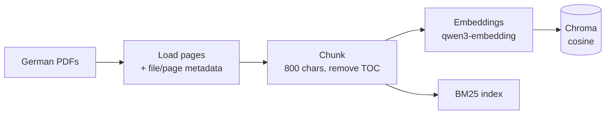
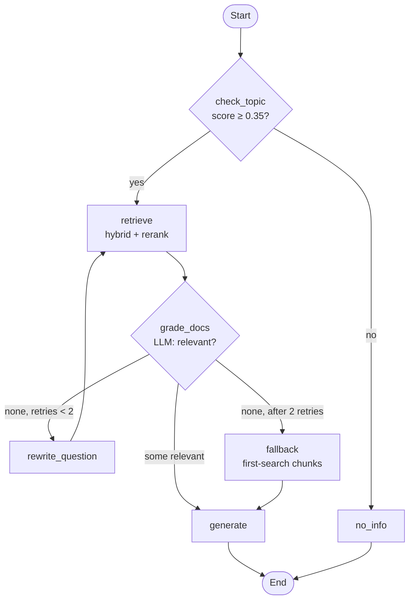

# German RAG Assistant

A retrieval-augmented generation (RAG) system that answers questions about **German university documents** (study and examination regulations of the University of Passau). It runs **fully locally**: embeddings, reranker and LLM all run on your own machine, so no documents leave it.

Every answer is in German and cites its sources (file + page). Questions outside the documents get "Dazu habe ich keine Informationen in meinen Dokumenten." instead of a made-up answer.

It comes in two versions:
- **Simple pipeline** (`answer.py`): hybrid search → reranking → LLM
- **Self-correcting agent** (`graph.py`, LangGraph): grades the retrieved chunks, rewrites the question if nothing relevant is found, and falls back safely

## Results

**Retrieval** – 25-question test set (German + English), hit rate = correct chunk among the top 4:

| Version | Hit rate |
| --- | --- |
| Vector search only (baseline) | 76% |
| + removed table-of-contents chunks | 80% |
| + hybrid search (BM25 + vector) | 88% |
| **+ cross-encoder reranking** | **92%** |

**Agent vs simple pipeline** – 5 hard questions, answers checked by hand:

| | Result |
| --- | --- |
| Agent better | 2 (fixed a wrong rule and a wrong date) |
| Equal | 3 |
| Agent worse | 0 |
| Extra time | ~1–2 s, ~15–20 s when rewrites are needed |

Details, remaining misses and debugging findings: [results.md](results.md)

## How it works

### Indexing



1. **Load:** PDFs are read page by page; each page keeps its file name and page number.
2. **Chunk:** pages are split into ~800-character chunks with overlap; table-of-contents chunks are filtered out.
3. **Index:** chunks are embedded locally and stored in Chroma (cosine distance); a BM25 keyword index is built with a German tokenizer.

### Retrieval (both versions)

- **Hybrid search:** BM25 (exact words like names, dates, § numbers) and vector search (meaning) are merged with Reciprocal Rank Fusion.
- **Rerank:** a multilingual cross-encoder re-scores the candidates and keeps the best 4.
- **Token budget:** chunks are added until the context limit (counted with the Qwen tokenizer).

### Self-correcting agent (LangGraph)



| Node | What it does |
| --- | --- |
| `check_topic` | Blocks off-topic questions before any LLM call |
| `retrieve` | Hybrid search + reranking + token budget |
| `grade_docs` | The LLM checks each chunk ("ja/nein") and drops irrelevant ones |
| `rewrite_question` | Rephrases the search query with legal terms, using the failed query as input |
| `fallback` | If the grader rejects everything, uses the reranked chunks from the first search |
| `generate` | Answers in German with sources, or says "no info" if the answer is missing |

All steps are traced with **LangSmith**.

## Tech stack

| Part | Tool |
| --- | --- |
| Framework | LangChain, LangGraph |
| PDF loading | PyPDFLoader |
| Embeddings | `qwen3-embedding:0.6b` via Ollama |
| Vector DB | Chroma |
| Keyword search | BM25 (`rank-bm25`) |
| Reranker | `BAAI/bge-reranker-v2-m3` (sentence-transformers) |
| LLM | `qwen3.5:4b` via Ollama |
| Observability | LangSmith |
| Package manager | uv |

## Project structure

```text
RAG/
├── data/            # German PDFs
├── src/
│   ├── load.py      # load PDFs with file/page metadata
│   ├── chunk.py     # split into chunks, remove TOC chunks
│   ├── vectordb.py  # embeddings + Chroma (build / load)
│   ├── hybrid.py    # BM25 + vector hybrid retriever
│   ├── rerank.py    # cross-encoder reranking
│   ├── answer.py    # simple RAG pipeline
│   ├── graph.py     # self-correcting LangGraph agent
│   ├── tests.py     # 25 test questions + off-topic questions
│   ├── debug.py     # retrieval hit rate: vector vs hybrid vs rerank
│   └── compare.py   # simple pipeline vs agent (answers + time)
├── results.md       # evaluation results and findings
└── pyproject.toml
```

## Setup

Requirements: Python 3.12, [uv](https://docs.astral.sh/uv/), [Ollama](https://ollama.com). An NVIDIA GPU is optional (speeds up reranking).

```bash
# 1. Clone and install
git clone https://github.com/pratham636/german-rag-assistant.git
cd german-rag-assistant
uv sync

# 2. Download the local models
ollama pull qwen3-embedding:0.6b
ollama pull qwen3.5:4b

# 3. Put your PDFs into data/

# 4. Build the vector database (first run only)
uv run src/vectordb.py
```

Optional, for LangSmith tracing, create a `.env` file:

```text
LANGSMITH_TRACING=true
LANGSMITH_API_KEY=your_key
LANGSMITH_PROJECT=german-rag-assistant
```

## Usage

Ask questions with the agent:

```bash
uv run src/graph.py
```

Example:

```text
=== Was passiert, wenn man eine Frist aus Gründen nicht einhalten kann, die man nicht zu vertreten hat?
   [retrieve] -> 4 chunks
   [grade] 1/4 chunks relevant
A: In diesem Fall wird eine Nachfrist gewährt [1].
   [1] LL.B._Legal_Tech.pdf S.19
```

Other scripts:

```bash
uv run src/answer.py    # simple pipeline
uv run src/debug.py     # retrieval evaluation
uv run src/compare.py   # simple pipeline vs agent
```

After changing the PDFs, chunk size or embedding model, delete `chroma_db/` and rebuild.

## Limitations

- **Small local LLM:** the 4B model sometimes mixes up items in list-structured documents even when retrieval is correct (see [results.md](results.md)).
- **Weak grader:** the 4B model as relevance judge is inconsistent (sometimes too lenient, sometimes too strict); the fallback limits the damage.
- **Legal structure:** § numbers and their titles can end up in different chunks, so questions like "Was regelt § 4?" are hard.
- **Evaluation:** retrieval is measured automatically; answer quality is so far checked by hand.
- **LangSmith** is a cloud service; turn tracing off for a fully local setup.

## Next steps

- Answer evaluation with RAGAS
- PGVector instead of Chroma
- Security layer (prompt-injection filter)
- FastAPI endpoint + Docker
- § numbers as chunk metadata