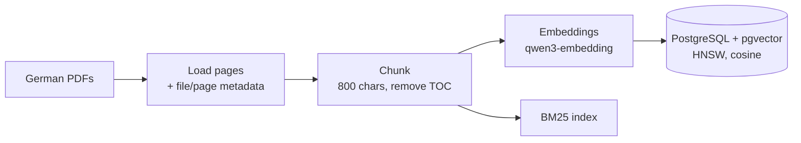
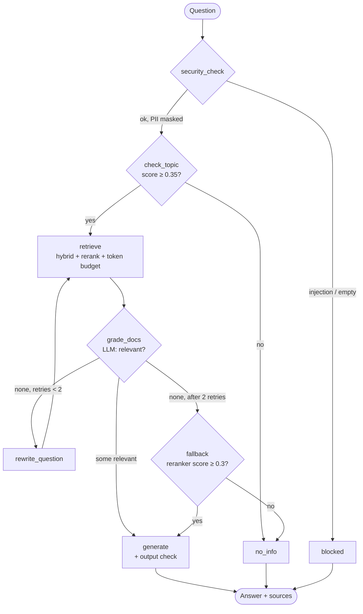

# German RAG Assistant

A retrieval-augmented generation (RAG) system that answers questions about **German university documents** (study and examination regulations of the University of Passau). All models (embeddings, reranker and LLM) run **locally**; vectors are stored in **PostgreSQL + pgvector**.

Answers are in German and cite their sources (file + page). If the documents don't contain the answer, the system says "Dazu habe ich keine Informationen in meinen Dokumenten." instead of making one up.

- **Self-correcting agent** (LangGraph): grades retrieved chunks, rewrites the query if nothing relevant is found, falls back only when confident
- **Hybrid search + reranking:** BM25 + vector search, cross-encoder reranking
- **Security layer:** prompt-injection filter, PII masking, output check
- **Production setup:** FastAPI, Docker, structured logging, LangSmith tracing
- **Evaluated:** retrieval hit rate, RAGAS answer quality, real user questions, security tests

## Results

| What | Result |
| --- | --- |
| Retrieval hit rate, 40 synthetic questions (vector → hybrid + rerank) | **58% → 73%** |
| Real student questions, answerable (retrieval) | 5/8 |
| Real student questions, not covered by the documents (honest "no info") | **7/7** |
| RAGAS answer relevancy, agent vs simple pipeline (8B judge, 65 questions) | **0.60 vs 0.53** |
| Security tests | 22 passed, 2 documented limitations |

Main remaining failure: **programme confusion**. Questions about a small regulation (8 pages) retrieve a large module catalogue (138 pages) instead.

Full numbers, failure analysis and design decisions: **[results.md](results.md)**

## Architecture

### Indexing



### Question answering (LangGraph agent)



| Node | What it does |
| --- | --- |
| `security_check` | Blocks prompt injection and empty/too-long input, masks e-mail, phone and IBAN |
| `check_topic` | Blocks off-topic questions before any LLM call |
| `retrieve` | Hybrid search (BM25 + vector, Reciprocal Rank Fusion) → cross-encoder rerank → token budget |
| `grade_docs` | The LLM checks each chunk and drops irrelevant ones |
| `rewrite_question` | Rephrases the search query, using the failed query as input |
| `fallback` | Uses first-search chunks only if the reranker is confident, otherwise "no info" |
| `generate` | Answers in German with sources; the output check blocks prompt leaks |

## Tech stack

| Part | Tool |
| --- | --- |
| Framework | LangChain, LangGraph |
| Embeddings | `qwen3-embedding:0.6b` via Ollama |
| Vector DB | PostgreSQL + pgvector (Supabase) via `langchain-postgres` |
| Keyword search | BM25 (`rank-bm25`) |
| Reranker | `BAAI/bge-reranker-v2-m3` (sentence-transformers) |
| LLM | `qwen3.5:4b` via Ollama |
| API | FastAPI + Uvicorn |
| Deployment | Docker |
| Evaluation | custom hit-rate scripts, RAGAS, pytest |
| Observability | LangSmith, Python logging |
| Package manager | uv |

## Project structure

```text
RAG/
├── data/                  # German PDFs
├── src/
│   ├── config.py          # all settings in one place
│   ├── logger.py          # logging setup
│   ├── load.py            # load PDFs with file/page metadata
│   ├── chunk.py           # split into chunks, remove TOC chunks
│   ├── vectordb.py        # embeddings + PGVector (build / load)
│   ├── hybrid.py          # BM25 + vector hybrid retriever
│   ├── rerank.py          # cross-encoder reranking
│   ├── security.py        # injection filter, PII masking, output check
│   ├── answer.py          # simple RAG pipeline
│   ├── graph.py           # LangGraph agent
│   ├── api.py             # FastAPI: /health, /ask
│   ├── tests.py           # test questions (synthetic + real)
│   ├── debug.py           # retrieval hit rate: vector vs hybrid vs rerank
│   ├── eval_real.py       # real user questions: retrieval + honesty
│   └── evaluate_ragas.py  # RAGAS: simple pipeline vs agent
├── tests/
│   └── test_security.py   # pytest security tests
├── Dockerfile
├── .env.example
├── results.md             # all evaluation results and findings
└── pyproject.toml
```

## Setup

Requirements: Python 3.12, [uv](https://docs.astral.sh/uv/), [Ollama](https://ollama.com), a [Supabase](https://supabase.com) project (free tier). An NVIDIA GPU is optional.

**1. Install**

```bash
git clone https://github.com/pratham636/german-rag-assistant.git
cd german-rag-assistant
uv sync
ollama pull qwen3-embedding:0.6b
ollama pull qwen3.5:4b
```

**2. Database:** create a Supabase project, enable the `vector` extension, and copy the **Session pooler** connection string into `.env` (see `.env.example`):

```text
DATABASE_URL=postgresql+psycopg://postgres.<project>:<password>@aws-0-eu-central-1.pooler.supabase.com:5432/postgres
```

**3. Build the index** (PDFs in `data/`):

```bash
uv run src/vectordb.py --build
```

**4. Index and security** (Supabase → SQL Editor):

```sql
create index if not exists embedding_hnsw_idx
on langchain_pg_embedding using hnsw (embedding vector_cosine_ops);

alter table langchain_pg_collection enable row level security;
alter table langchain_pg_embedding enable row level security;
```

## Usage

**API**

```bash
uv run uvicorn api:api --app-dir src --port 8000
```

Open http://127.0.0.1:8000/docs and try `POST /ask`:

```json
{ "question": "Bis wann kann man von Prüfungen zurücktreten?" }
```

```json
{
  "answer": "Bis zum 11. Januar 2027 [1].",
  "sources": ["[1] Bekanntmachung_Präsenzprüfungen_WiSe.pdf S.1"],
  "blocked": false,
  "latency_s": 5.4
}
```

**Docker** (Ollama runs on the host):

```bash
docker build -t german-rag .
docker run -p 8000:8000 --env-file .env -v hf-cache:/root/.cache/huggingface german-rag
```

**Evaluation**

```bash
uv run pytest -v                 # security tests
uv run src/debug.py              # retrieval hit rate
uv run src/eval_real.py          # real user questions
uv run src/evaluate_ragas.py     # RAGAS (slow)
```

## Design decisions

- **Honesty over coverage:** the fallback only answers when the reranker is confident. This removed all invented answers on real unanswerable questions (5/7 → 7/7), at the cost of one answerable question.
- **Reranker on CPU, LLM on GPU:** on an 8 GB laptop GPU, PyTorch and Ollama conflicted; the LLM is the bottleneck, so it gets the GPU.
- **Local models:** no API limits, no cost, documents stay on the machine (except the vector store and optional tracing).

## Limitations

- **Small LLM:** the 4B model sometimes mixes up items in list-structured documents, and is an inconsistent relevance grader.
- **Programme confusion:** similar regulations from different study programmes get mixed up.
- **Evaluation:** test sets are small; RAGAS uses a local 8B judge, so scores are indicative.
- **Security:** rule-based filters can be bypassed with creative rephrasing.
- **Cloud parts:** vectors are stored in Supabase and traces go to LangSmith. For a fully local setup, run Postgres + pgvector in Docker and turn tracing off.

## Next steps

- Metadata filter by study programme
- Contextual retrieval (prefix chunks with document and § context)
- Route only low-confidence questions through the agent
- LLM-based prompt-injection classifier