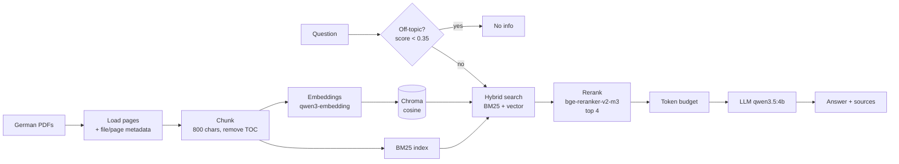

# German RAG Assistant

A retrieval-augmented generation (RAG) system that answers questions about **German university documents** (study and examination regulations of the University of Passau). It runs **fully locally**: embeddings, reranker and LLM all run on your own machine, so no documents leave it.

Every answer is in German and cites its sources (file + page). Questions outside the documents get "Dazu habe ich keine Informationen in meinen Dokumenten." instead of a made-up answer.

## Results

Retrieval evaluated on a 25-question test set (German + English questions), hit rate = correct chunk among the top 4:

| Version | Hit rate |
| --- | --- |
| Vector search only (baseline) | 76% |
| + removed table-of-contents chunks | 80% |
| + hybrid search (BM25 + vector) | 88% |
| **+ cross-encoder reranking** | **92%** |

Details, remaining misses and findings: [results.md](results.md)

## How it works



1. **Load:** PDFs are read page by page; each page keeps its file name and page number.
2. **Chunk:** pages are split into ~800-character chunks with overlap; table-of-contents chunks are filtered out.
3. **Index:** chunks are embedded locally and stored in Chroma (cosine distance); a BM25 keyword index is built with a German tokenizer.
4. **Off-topic check:** if the best vector score is below 0.35, the system answers "no information" without calling the LLM.
5. **Hybrid search:** BM25 (exact words like names, dates, § numbers) and vector search (meaning) are merged with Reciprocal Rank Fusion.
6. **Rerank:** a multilingual cross-encoder re-scores the candidates and keeps the best 4.
7. **Token budget:** chunks are added until the context limit (counted with the Qwen tokenizer).
8. **Generate:** the local LLM answers in German and cites the sources.

All steps are traced with **LangSmith**.

## Tech stack

| Part | Tool |
| --- | --- |
| Framework | LangChain |
| PDF loading | PyPDFLoader |
| Embeddings | `qwen3-embedding:0.6b` via Ollama |
| Vector DB | Chroma |
| Keyword search | BM25 (`rank-bm25`) |
| Reranker | `BAAI/bge-reranker-v2-m3` (sentence-transformers) |
| LLM | `qwen3.5:4b` via Ollama |
| Observability | LangSmith |
| Package manager | uv |

## Project structure

```text
RAG/
├── data/            # German PDFs
├── src/
│   ├── load.py      # load PDFs with file/page metadata
│   ├── chunk.py     # split into chunks, remove TOC chunks
│   ├── vectordb.py  # embeddings + Chroma (build / load)
│   ├── hybrid.py    # BM25 + vector hybrid retriever
│   ├── rerank.py    # cross-encoder reranking
│   ├── answer.py    # full RAG pipeline (ask a question)
│   ├── tests.py     # 25 test questions + off-topic questions
│   └── debug.py     # hit rate: vector vs hybrid vs rerank
├── results.md       # evaluation results and findings
└── pyproject.toml
```

## Setup

Requirements: Python 3.12, [uv](https://docs.astral.sh/uv/), [Ollama](https://ollama.com). An NVIDIA GPU is optional (speeds up reranking).

```bash
# 1. Clone and install
git clone https://github.com/pratham636/german-rag-assistant.git
cd german-rag-assistant
uv sync

# 2. Download the local models
ollama pull qwen3-embedding:0.6b
ollama pull qwen3.5:4b

# 3. Put your PDFs into data/

# 4. Build the vector database (first run only)
uv run src/vectordb.py
```

Optional, for LangSmith tracing, create a `.env` file:

```text
LANGSMITH_TRACING=true
LANGSMITH_API_KEY=your_key
LANGSMITH_PROJECT=german-rag-assistant
```

## Usage

Ask questions:

```bash
uv run src/answer.py
```

Example:

```text
Q: Wie oft darf man eine Prüfung wiederholen?
A: Eine nicht bestandene Prüfung kann grundsätzlich zweimal wiederholt werden [1].
   [1] AStuPO_M_JUR.pdf S.9
```

Run the retrieval evaluation:

```bash
uv run src/debug.py
```

After changing the PDFs, chunk size or embedding model, delete `chroma_db/` and rebuild.

## Limitations

- **Small local LLM:** the 4B model sometimes mixes up items in list-structured documents even when retrieval is correct (see [results.md](results.md)).
- **Legal structure:** § numbers and their titles can end up in different chunks, so questions like "Was regelt § 4?" are hard.
- **Evaluation:** hit rate measures retrieval only; answer quality is not yet measured automatically.
- **LangSmith** is a cloud service; turn tracing off for a fully local setup.

## Next steps

- LangGraph agent with document grading and query rewriting
- Answer evaluation with RAGAS
- § numbers as chunk metadata
- FastAPI endpoint + Docker
